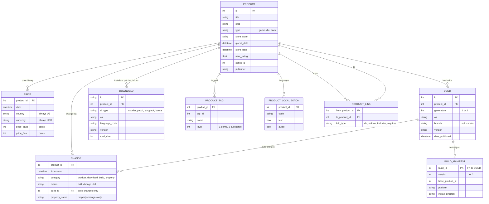

# GOG DB Entity Relationship Diagram

How the JSON files break into tables once they're flattened. Wide nested parts (download file lists, depot details, cloud saves) are left out.

`PRODUCT_LINK` holds `dlcs`, `editions`, `includes_games` and `requires`. `is_included_in` and `required_by` are the same links read in reverse. `DOWNLOAD` holds the four `dl_*` arrays, with `dl_type` saying which one.

Column descriptions are in the [data dictionary](data_dictionary.md).
